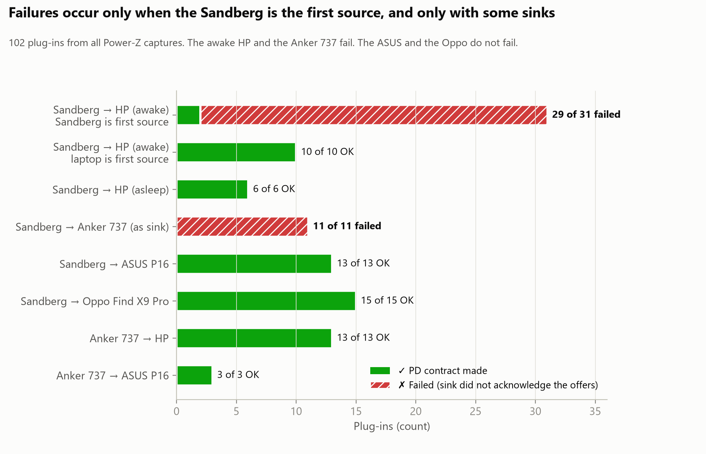
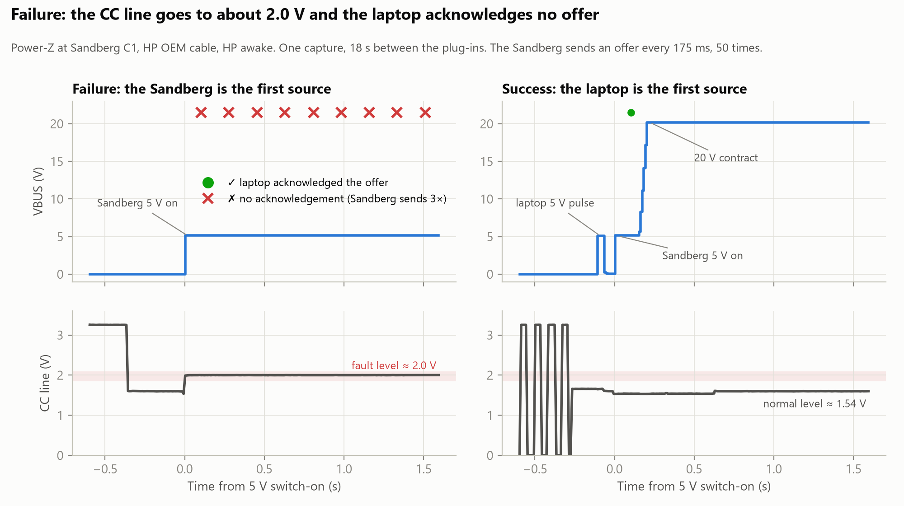
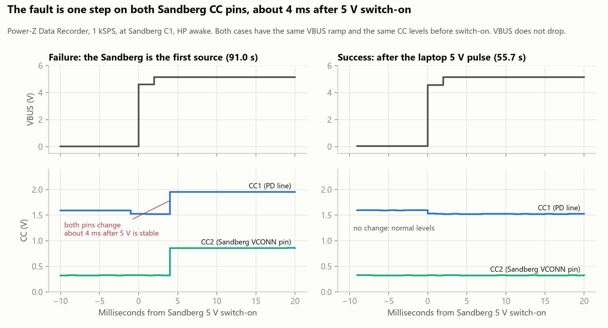
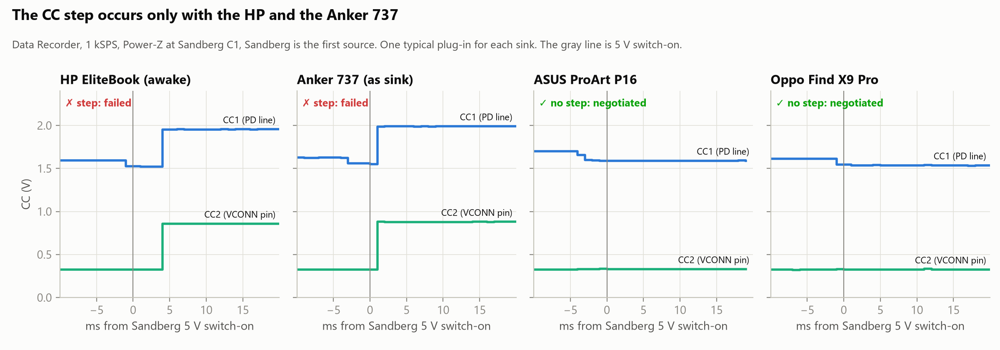
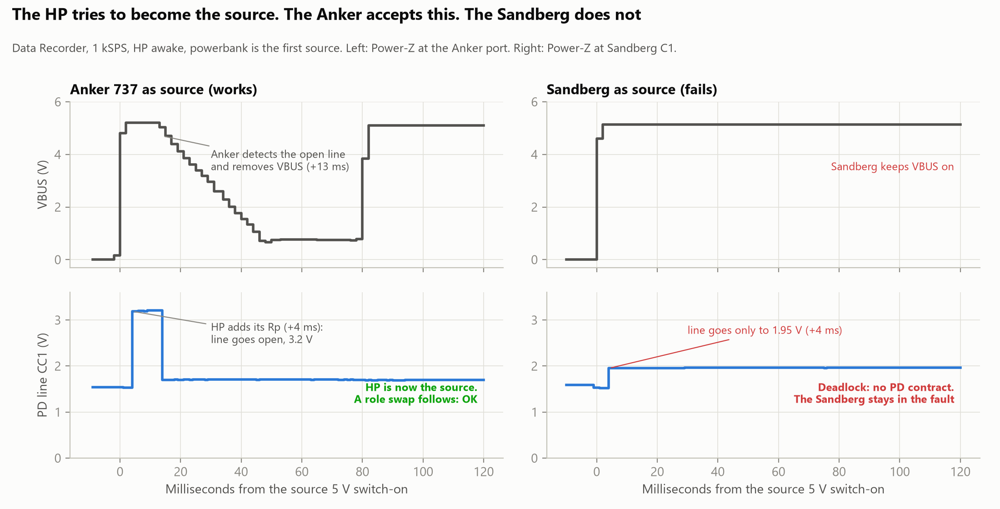
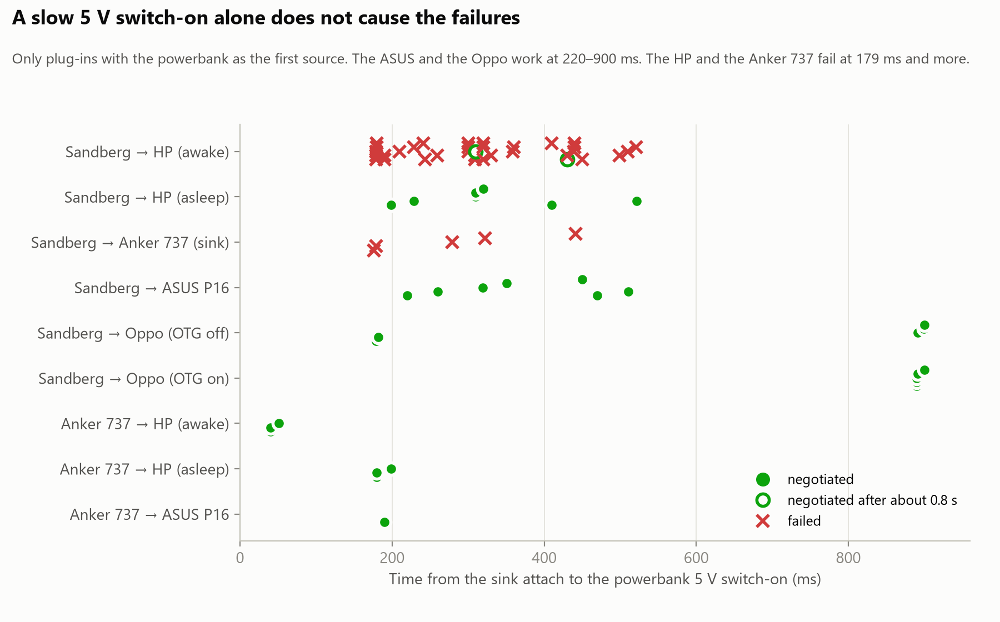
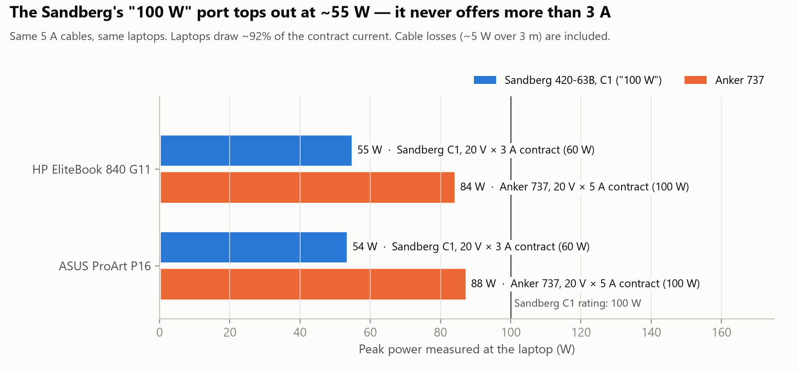

# USB-C PD investigation: Sandberg 420-63B powerbank and HP EliteBook 840 G11

> **Status:** active investigation. Last update: 2026-11-11.
> All captures come from a ChargerLAB **Power-Z** (KM series) and its PC software. The decoded source files are the `.sqlite` and `.db` files in this folder.

## Contents

1. [Summary](#1-summary)
2. [Devices and cables](#2-devices-and-cables)
3. [Capture index](#3-capture-index)
4. [Finding A: intermittent negotiation failure (Sandberg + some sinks)](#4-finding-a-intermittent-negotiation-failure-sandberg--some-sinks)
5. [Finding B: Sandberg C1 never offers more than 60 W](#5-finding-b-sandberg-c1-never-offers-more-than-60-w)
6. [Finding C: other protocol quirks](#6-finding-c-other-protocol-quirks)
7. [Timing and power measurements](#7-timing-and-power-measurements)
8. [Open questions and test plan](#8-open-questions-and-test-plan)
9. [Background: USB-C / PD concepts used here](#9-background-usb-c--pd-concepts-used-here)
10. [How we decoded the captures](#10-how-we-decoded-the-captures)

---

## 1. Summary

The Sandberg powerbank has **two independent problems**:

| # | Problem | Most likely cause | Confidence |
|---|---|---|---|
| **A** | Some sinks do not answer the power offers when the **Sandberg powers on first**. The Sandberg sends 50 offers in about 8.6 s. Then it stops and stays at 5 V with no charging | The **HP (awake)** and the **Anker 737** try to become the source a few ms after VBUS comes on (Try.SRC behaviour). A compliant source (the Anker) detects this and removes VBUS. The **Sandberg does not**. It keeps VBUS on and goes into a CC fault state that it does not leave until you unplug the cable from the Sandberg | The pattern is the same in all 102 plug-ins. The reference recordings show the mechanism (section 4.4) |
| **B** | The Sandberg "100 W" port (C1) always offers **20 V 3 A = 60 W** at most | The **Sandberg does not supply VCONN**, so it cannot read the cable e-marker. The PD specification then limits the source to 3 A | **Proven by measurement** |

We also recorded a **third fault, on the C2 (27 W) port only**. On C2 the Sandberg does not run PD and supplies only about 4.6 V. The laptop then charges slowly at 5 V (section 4.5).



These items do **not** cause the problems:

- The "Vendor Defined" packets before a failure. They are the Sandberg cable check.
- The cables. We tested three different 5 A e-marked cables.
- The laptop restart.

---

## 2. Devices and cables

### Power sources

| Device | Rated USB-C output | Captured offer |
|---|---|---|
| **Sandberg Powerbank USB-C PD 127W 40000**, item 420-63B, 148 Wh | C1: 5/9/12/15 V 3 A, **20 V 5 A (100 W)**. C2: 27 W. USB-A: 22.5 W. 127 W is C1 + C2 together ([manual](https://sandberg.world/nl-nl/mt/manual/420-63)) | C1: Fixed 5/9/12/15/20 V **at 3 A**, PPS 3.3–16 V 3 A, PPS 3.3–21 V 3 A. Flags: DRP, Unconstrained, DRD. **Never 5 A** |
| **Anker 737 PowerCore 24K** (A1289), 86.4 Wh | Each C port: up to 28 V 5 A, 140 W ([Anker](https://service.anker.com/article-description/Introduction-to-the-Anker-737-Power-Bank-24K-A1289)) | Fixed 5/9/12/15 V 3 A, **20 V 5 A**, PPS 3.3–21 V 5 A. Flags: DRP, Unconstrained, DRD, EPR |

### Sinks (laptops)

| Device | USB-C input | Measured |
|---|---|---|
| **HP EliteBook 840 G11**, 56 Wh | HP supplies a 65 W USB-C adapter. HP also lists a 110 W USB-C adapter for this model | Requests 20 V 5 A when the source offers it. Takes up to **4.29 A (about 84 W)** |
| **ASUS ProArt P16 H7606**, 90 Wh | USB-C PD 45–100 W (third-party specifications). Barrel adapter 200/240 W | Requests 20 V 5 A when the source offers it. Takes up to **4.58 A (87.5 W)** |

### Cables (decoded e-marker identity)

| Cable | ID Header | Cert (XID) | Cable VDO | Meaning |
|---|---|---|---|---|
| Anker 100 W, 3 m | `18000000` | none | `00086840` | Passive, **5 A**, 20 V, USB 2.0, latency for about 2–3 m |
| StarTech | `186014B0` (VID 0x14B0) | `0000340C` | `000A4641` | Passive, **5 A**, **50 V / EPR capable**, USB 3.2 Gen 1 |
| HP OEM (P/N F0KYM-HTN1-533) | `1860228A` (VID 0x228A) | `00000297` (certified) | `00082042` | Passive, **5 A**, 20 V, USB 3.2 Gen 2, about 1 m |

All three cables send a valid identity reply when the requester supplies VCONN.

---

## 3. Capture index

"Power-Z at laptop" means: laptop ← Power-Z ← cable ← powerbank. "At C1" means: the Power-Z is in the Sandberg C1 port.

| File | Setup | Laptop state | Result |
|---|---|---|---|
| `ANKER100W3mCablepd.sqlite` | Sandberg, Anker cable, Power-Z at laptop | Awake | Several failures, 1 OK |
| `ANKER100W3mCableAttempt2pd.sqlite` | Same | Awake | Failures, then OK |
| `ANKER100W3mCableAttempt3Failed_pd.sqlite` | Same | Awake | FAIL |
| `StarTechCable_Success-Fail.sqlite` | Sandberg, StarTech cable | Awake | 2 OK, 2 FAIL |
| `ANKER100W3mCableAfterLaptopRestartpd.sqlite` | Sandberg, Anker cable | **Asleep**, about 90% | 3 of 3 OK |
| `StarTechCable_Success_AfterRestart.sqlite` | Sandberg, StarTech | **Asleep**, about 90% | 3 of 3 OK |
| `ANKER100W3mCableAfterLaptopRestartON50pd.sqlite` | Sandberg, Anker cable | Awake, about 50%, high load | 3 OK (2 with about 0.7 s delay) |
| `ANKER100W3mCableAfterLaptopRestartON_below30pd.sqlite` | Sandberg, Anker cable | Awake, below 30% | **5 FAIL**, 1 OK |
| `ASUSProArtP16ANKER100W3mCablepd.sqlite` | Sandberg → ASUS | Awake | 2 of 2 OK (60 W) |
| `Anker737PowerCore24K/Anker100WCableAnker737PBpd.sqlite` | Anker 737 → HP | Asleep | 3 of 3 OK (100 W) |
| `Anker737PowerCore24K/Anker100WCableAnker737PBAfterRestartONpd.sqlite` | Anker 737 → HP | Awake | 3 of 3 OK |
| `Anker737PowerCore24K/Anker100WCableAnker737PBAfterRestartON100Wpd.sqlite` | Anker 737 ↔ HP | Awake | OK. The laptop was the first source. Then a role swap, then 100 W |
| `Anker737PowerCore24K/ANKER100WCableASUSProArtP16pd.sqlite` | Anker 737 → ASUS | Awake | 3 of 3 OK (100 W) |
| `F0KYM-HTN1-533/Sandberg-Ankerpd.sqlite` | HP cable: Sandberg C1 → C2 → C1, then Anker 737 | Awake | C1 OK, C2 no PD, C1 FAIL, C1 OK, Anker OK |
| `F0KYM-HTN1-533/Sandberg3Fails1OK_PowerZ_at_C1pd.sqlite` | **Power-Z at Sandberg C1**, HP cable | Awake | 3 FAIL, 1 OK |
| `F0KYM-HTN1-533/Sandberg3Fails1OK_PowerZ_at_C1_WorstSoFar_27Wpd.sqlite` | Power-Z at **Sandberg C2 (27 W)**, HP cable | Awake | **No PD.** The Sandberg supplies about 4.6 V and ignores 3 Hard Resets from the laptop. The laptop charges at 5 V (13.9 W maximum) and attaches again every 10 s (section 4.5) |
| `F0KYM-HTN1-533/Sanberg_several_retries15s_AnkerOKpd.sqlite` | Power-Z at Sandberg C1, HP cable. Unplug at the laptop, **wait 15 s**, plug in again. Then Anker 737 | Awake | **Sandberg 4 of 4 FAIL** (all Sandberg first). Anker OK (laptop first, PR_Swap, 5 A) |
| `F0KYM-HTN1-533/HPEliteBookT2-testpd.sqlite` | **T2**: Power-Z at C1, HP cable, 15 s wait | Awake | First plug-in FAIL. Then the Sandberg **stays in the fault for 2 minutes**, through 4 plug-ins (section 4.3) |
| `F0KYM-HTN1-533/ASUSProArtP16T4-testpd.sqlite` | **T4**: Sandberg → ASUS, 15 s wait | Awake | **6 of 6 OK**, all Sandberg first, 20 V 3 A, 55 W |
| `F0KYM-HTN1-533/Sandberg_Charging_Anker737_T5-testpd.sqlite` | **T5**: Sandberg → Anker 737 (as sink), 15 s wait | — | First plug-in FAIL. The same fault as with the HP, through 4 plug-ins |
| `F0KYM-HTN1-533/Oppo_T7-OTG-offpd.sqlite` | **T7**: Sandberg → Oppo Find X9 Pro, OTG off | — | **5 of 5 OK**. Uses the Sandberg **PPS** (about 8.5 V 3 A, up to 26 W) |
| `F0KYM-HTN1-533/Oppo_T7-OTG-onpd.sqlite` | **T7**: same, OTG on | — | **5 of 5 OK**. Fixed 9 V 1.5–2 A |
| `F0KYM-HTN1-533/HPEliteBookT2-test_T5bpd.sqlite` | **T5b**: HP. Unplug at the Sandberg between attempts | Awake | **5 of 5 FAIL** (each attempt starts from 0 V) |
| `F0KYM-HTN1-533/Sandberg_Charging_Anker737_T5b-testpd.sqlite` | **T5b**: Anker 737 as sink. Unplug at the Sandberg between attempts | — | **5 of 5 FAIL** (each attempt starts from 0 V) |
| `F0KYM-HTN1-533/T5bSandberg_Charging_HPuserdata.db` | **T5b repeat, Data Recorder 1 kSPS** (analog values only, no PD messages), HP, Power-Z at C1 | Awake | 4 FAIL, 1 OK (laptop first). Shows the fault step about 4 ms after switch-on |
| `F0KYM-HTN1-533/DR1kSPS_Anker_Charging_HPuserdata.db` | **Reference, Data Recorder 1 kSPS**: Anker 737 → HP, Power-Z at the Anker port. Unplug at the Anker | Awake | All OK. The HP adds Rp 4 ms after the Anker switches 5 V on. The Anker removes VBUS within 13 ms. Then the HP is the source, and a role swap follows |
| `F0KYM-HTN1-533/DR1kSPS_Anker_Charging_Sandberguserdata.db` | **Reference**: Anker 737 ↔ Sandberg, Power-Z at the Anker port | — | The Sandberg won the race and became the source. Then the same fault as with the HP occurred. The Anker showed Rp on its VCONN pin 1 ms after VBUS. The PD line went to 2.0 V, and the Sandberg stayed stuck |
| `F0KYM-HTN1-533/DR1kSPS_Anker_Charging_Asususerdata.db` | **Reference**: Anker 737 → ASUS, Power-Z at the Anker port | Awake | All OK. The ASUS does not add Rp after VBUS |

---

## 4. Finding A: intermittent negotiation failure (Sandberg + some sinks)

### 4.1 Sequence of a failure

```
SOP'  Discover_Identity (×3, no reply)          ← the Sandberg tries to read the cable (no reply, always)
SOP   Source_Capabilities id=0 (×3, no GoodCRC) ← the sink does not send the low-level acknowledgement
SOP   Source_Capabilities id=1 (×3, no GoodCRC)
...   every ~175 ms, 50 times (nCapsCount) ≈ 8.6 s
      → the Sandberg stops. VBUS stays at 5 V. No contract, no Hard Reset, no retry
```

- The sink sends **no GoodCRC**. GoodCRC is the automatic low-level acknowledgement. Thus the sink receiver does not decode the Sandberg messages.
- The sink also sends no Hard Reset. A sink must send one if it receives no offer within about 0.6 s.
- The Sandberg does not recover. Only a new plug-in helps (see 4.3 for which end to unplug).

### 4.2 Electrical signature (in every failure)

| Measurement | Success | Failure |
|---|---|---|
| PD line (communication CC) after 5 V switch-on | about **1.53 V** | about **1.95–2.01 V** |
| Laptop VCONN-side CC pin (meter at laptop) | 0 V | **0.55 V**. This is the laptop pull-up (Rp) into the cable resistor (Ra). The laptop behaves like a power source |
| Sandberg VCONN-side CC pin (meter at C1) | 0.32 V | **0.85 V** |
| Current at 5 V | 0 mA | **51 mA** for about 0.9 s |

The fault starts 3–5 ms after the Sandberg switches 5 V on (see 4.4). In a failure, the fault does not stop. In the 50% capture, the fault stopped after about 0.57 s, so those plug-ins succeeded late.



*Left: the Sandberg powers on first. The PD line goes to about 2.0 V and the laptop ignores every offer. Right: the laptop supplies 5 V for a short time first. Then the Sandberg starts to supply power. The laptop acknowledges the first offer within about 0.1 s.*

### 4.3 What decides success or failure

Both devices are **dual-role ports (DRP)**. Each device can supply power or take power. When nothing is attached, each device changes between the two roles.

**Laptop side:**

| HP state | Offers power when nothing is attached? | Failures |
|---|---|---|
| Asleep (Modern Standby) | No, sink only | **None** (9 of 9 OK) |
| Awake (any battery level) | Yes, about 50% of the time | Yes |

**Sandberg side** (Power-Z at C1):

- With **nothing attached** (cable out of the Sandberg), the Sandberg changes roles for about 5–7 s. Then it **stays as a source**.
- With **the cable attached** (unplugged only at the laptop end), the Sandberg sees the cable Ra and **continues to change roles**. We measured 15–18 s.

**The device that is the first source decides the result:**

| First source | Sequence | Result (HP awake) |
|---|---|---|
| **Laptop first** (the laptop finds the Sandberg in its sink role) | The laptop supplies **5.05–5.10 V** for a short time. Then the Sandberg becomes the source and switches 5 V on **about 80 ms** later | **OK** every time |
| **Sandberg first** (fixed source, or the Sandberg wins the race) | The Sandberg switches 5 V on **179–521 ms** after the sink attaches. Its VCONN pin goes from 0.32 V to 0.86 V | **Failure**, 29 of 31 times |

- If the cable is out of the Sandberg for more than 7 s, the Sandberg is always the first source. Then the plug-in always fails.
- If the cable stays in the Sandberg, the result is a random race.

**Other partners, with the Sandberg as the first source (tests T2–T7, T5b):**

| Sink | Sandberg-first plug-ins | Result | Sandberg 5 V switch-on delay |
|---|---|---|---|
| HP EliteBook (awake) | 31 (all captures, with 9 independent T5b attempts) | **29 FAIL**, 2 late OK | 179–521 ms |
| **Anker 737 as sink** | 11 (with 10 independent T5b and T8 attempts) | **11 FAIL**, same signature (CC 1.96–2.00 V / 0.88 V) | 176–441 ms |
| ASUS ProArt P16 (awake) | 12 (and 1 with the ASUS as the first source) | **13 OK** | 220–511 ms |
| Oppo Find X9 Pro, OTG off | 5 | **5 OK** | 179–900 ms |
| Oppo Find X9 Pro, OTG on | 5 | **5 OK** | 890–900 ms |
| Oppo Find X9 Pro (T8, Data Recorder) | 5 | **5 OK** | not measured |
| HP EliteBook (asleep) | 6 | **6 OK** | 199–522 ms |

Conclusions from this table:

- **The fault is not specific to the HP.** The Anker 737 fails in the same way.
- **The delay is not the cause.** The ASUS and the Oppo work with equal or longer delays.

**After a failure, the Sandberg stays in the fault (T2, T5).** The Sandberg kept **VBUS at 5.14 V for the full 2-minute capture**. It also kept the PD line at **about 1.94–1.98 V** and its VCONN pin at **0.86–0.88 V**. This continued during the 15 s periods when only the cable was attached. In that condition, a normal source measures about 3.25 V (an open pull-up). Then it detects the detach and switches VBUS off. The Sandberg did this in T4 and T7.

- Each new plug-in shows a 150 ms drop to about 1.52 V (the Rd of the new sink). Then the line goes back to the fault level.
- The Sandberg sends **no new offers** after a new plug-in.
- Only an unplug **at the Sandberg** clears the fault.

Thus the Sandberg itself causes the fault level on the CC pins, at least in part. The sink is not the only cause.

*In T2–T7 the cable stayed in the Power-Z at C1. We unplugged it only at the device end during the 15 s waits.*

**Below 30%:** we plugged in about every 15 s. The Sandberg was always a fixed source, so 5 of 6 plug-ins failed.

### 4.4 Working hypothesis

> **Revised after the reference recordings.** The fault is a role conflict that the Sandberg does not handle:
>
> 1. The Sandberg attaches as the source and switches VBUS on.
> 2. A few milliseconds later, the **HP (awake)** or the **Anker 737** changes its CC termination from Rd (sink) to **Rp (source)**. This is Try.SRC behaviour: a dual-role port that prefers the source role tries to take it.
> 3. A compliant source sees the PD line go open (both sides have Rp). It removes VBUS and lets the partner become the source. A role swap then gives a normal contract.
> 4. The **Sandberg does not see the open line**. The line goes only to about 1.95–2.0 V, not to about 3.2 V. The Sandberg keeps VBUS on, its VCONN pin goes to about 0.86 V, and no PD contract occurs. The Sandberg stays in this state until you unplug the cable from the Sandberg.
>
> The ASUS, the Oppo and the sleeping HP do not try to become the source after VBUS comes on. Thus they never cause the fault.

**Evidence from the reference recordings (Data Recorder, 1 kSPS):**

- **Anker 737 → HP:** the HP adds its Rp **4 ms** after the Anker switches 5 V on. The PD line goes to **3.2 V** (open). The Anker removes VBUS **13 ms** after switch-on. Then the HP supplies 5.10 V, and a role swap follows. Each plug-in worked.
- **Sandberg → HP:** the step on the Sandberg side occurs at **+3 to +5 ms**, the same time as the HP Rp step with the Anker. But the line goes only to about **1.95 V**, and VBUS stays on.
- **Anker 737 ↔ Sandberg:** the Sandberg became the source. The meter at the Anker port shows the Anker put Rp on its own VCONN pin (0 → 0.31 V) **1 ms** after VBUS. At the same time the PD line went to 2.0 V. This is the same fault, seen from the sink side.
- **Anker 737 → ASUS:** the ASUS does not add Rp after VBUS. Each plug-in worked.

Chart 7 below compares the same HP plug-in with the Anker and with the Sandberg as the source.

Other points from the data:

- On the HP side, we measured an Rp on the laptop VCONN pin during failures (0.55 V). This agrees with the HP in a source-like state.
- **A simple model gives the fault levels.** In the model, the Sandberg connects both CC pins to about 1.95 V through about 1.3 kΩ. A normal Rp is a 330 µA current source. The model gives:
  - 1.95 V with nothing attached (we measured 1.94 V).
  - About 0.86 V into the cable Ra (we measured 0.86 V).
  - About 1.55 V with only a sink Rd (we measured 1.52 V at a new plug-in).

Open questions:

- Why does the Sandberg keep the line at about 1.95 V and its VCONN pin at 0.86 V when the partner adds Rp? A normal source line goes to about 3.2 V. T9 can show the first microseconds.
- Does the fault CC level also prevent the sinks from decoding the Sandberg messages?

**Inrush current is now an unlikely cause.** The 1 kSPS Data Recorder run (below) shows no VBUS drop at switch-on. The fault starts **3–5 ms after VBUS is stable**. It is one step on both Sandberg CC pins at the same time.

**1 ms view of the fault (`T5bSandberg_Charging_HPuserdata.db`, 5 plug-ins, HP awake, Power-Z at C1):**

| Plug-in | Path | From 5 V switch-on to the CC step | Result |
|---|---|---|---|
| 2.3 s | Sandberg first | +5 ms: CC1 1.52 → 1.97 V, CC2 0.32 → 0.85 V | FAIL |
| 26.7 s | Sandberg first | +3 ms, same step | FAIL |
| 55.6 / 55.7 s | **Laptop first** (5.105 V for about 110 ms, then the Sandberg starts to supply power) | **no step** | **OK, 20 V** |
| 91.0 s | Sandberg first | +4 ms, same step | FAIL |
| 120.8 s | Sandberg first | +4 ms, same step | FAIL |

The single success used the laptop-first path. At that plug-in the Sandberg still changed roles, and the laptop found it in its sink role. The chart below compares a failure and the success:

- Both cases have the same VBUS ramp.
- Both cases have the same CC levels before switch-on.
- Only the path to the source role is different.
- Only the direct path gives the step.

Thus the cause is probably an action in the **Sandberg attach sequence**. Some milliseconds after VBUS switch-on, the Sandberg firmware changes both CC pins. A defective VCONN switch-on or a change of the pull-ups agrees with the data. The Sandberg does this when it attaches directly as a source. It does not do this when it becomes the source after a role swap. We do not know why the ASUS and the Oppo do not cause the fault.



**T8: the CC step with each sink (Data Recorder, 1 kSPS, Power-Z at C1, Sandberg is the first source):**

| Sink | Plug-ins | CC step after 5 V switch-on | Result |
|---|---|---|---|
| HP EliteBook (awake) | 4 (T5b recording) | **Yes**, at +3 to +5 ms | 4 FAIL |
| Anker 737 (as sink) | 5 | **Yes**, at +1 to +2 ms | 5 FAIL. The CC pins stay at 1.98–2.00 V / 0.88 V |
| ASUS ProArt P16 | 4 (and 1 with the ASUS as the first source) | **No** | 5 OK, 20 V |
| Oppo Find X9 Pro | 5 | **No** | 5 OK, PPS / 9 V |

What T8 shows:

- The CC step occurs with **each** failure and with **no** success. The step is the fault.
- The step occurs only with the HP and the Anker 737. It does not occur with the ASUS or the Oppo.
- The step time is different for each sink: +1 to +2 ms with the Anker, +3 to +5 ms with the HP. Thus the Sandberg probably reacts to something that the sink does just after VBUS comes on.
- Before switch-on, all four sinks show similar CC levels (Rd 1.59–1.70 V, cable Ra 0.32 V). The 1 kSPS data shows no difference that explains the step.
- The PD captures show no message from the sink before the step. The first PD message is the Sandberg SOP' probe, about 50 ms after switch-on. Thus the trigger is electrical, not a PD message.

To find the trigger, the next tool must sample faster than the Data Recorder. Use an oscilloscope or a logic analyzer on CC1, CC2 and VBUS at C1 (see test T9).





*The same HP, awake, with the powerbank as the first source. Left: the Anker removes VBUS after the HP adds its Rp, and the negotiation succeeds. Right: the Sandberg keeps VBUS on, and the negotiation fails.*



*The chart shows the time from the sink attach to the 5 V switch-on, for plug-ins with the powerbank as the first source. The ASUS and the Oppo work with the Sandberg at equal or longer delays. Thus the slow switch-on alone does not cause the fault.*

### 4.5 Second fault: the Sandberg PD engine does not operate

This fault occurs **on the C2 (27 W) port**. Both captures of it are on C2:

- `Sandberg3Fails1OK_PowerZ_at_C1_WorstSoFar_27Wpd.sqlite` (84 s, 7 cycles). The original file name says C1, but the recording is from C2.
- `Sandberg-Ankerpd.sqlite`, 1438–1448 s.

We did not see this fault on C1.

```
laptop attaches (Rd) → the Sandberg switches VBUS on at only ~4.6 V   (vSafe5V minimum is 4.75 V)
no Source_Capabilities, no SOP' probes: the Sandberg sends nothing
laptop: HARD_RESET ×3, ~1.25 s apart   (the specification requires this when no offer arrives)
the Sandberg ignores them (VBUS does not go to 0 V, which a source must do after a Hard Reset)
laptop uses Type-C current: 1.35 → 2.76 A at 4.4–5.0 V (13.9 W maximum)
after ~9 s the laptop detaches, ~3 s later it attaches again → loop
```

- Terminations at C1: Sandberg Rp (3 A level) on both pins, laptop Rd. Thus **the Sandberg is the source**.
- In this fault, the laptop operates as the specification requires. This is different from Finding A.
- The trigger is not known. It is possibly the Sandberg state, for example its battery charge or the result of earlier failures.

### 4.6 Workarounds

- Plug in when the laptop is **asleep**. Then wake the laptop. This is the only reliable workaround (9 of 9 OK).
- Keep the cable in the Sandberg and plug in again at the laptop. Each attempt is a race that the laptop sometimes wins. This works only if the last attempt did not leave the Sandberg in the fault.
- After a failure, **unplug the cable from the Sandberg**, not only from the laptop. If you do not, the Sandberg stays in the fault. Then try again.

---

## 5. Finding B: Sandberg C1 never offers more than 60 W

### 5.1 Evidence

- **Every** Sandberg C1 offer stops at **20 V 3 A**. This is true for all captures, both laptops and all three 5 A cables. The laptops then take about 2.76 A, 92% of the contract. That is about 54–55 W.
- The PD specification permits more than 3 A **only after the source reads "5 A" from the cable e-marker**. To read the e-marker, the source must supply **VCONN** to it.
- **The Sandberg does not supply VCONN.** Its own VCONN pin measures **0.32 V** in successful plug-ins. This is only its pull-up current into the 1 kΩ cable resistor. In failures it measures **0.85 V**. VCONN must be about 3–5.5 V.
- Thus the cable never answers the Sandberg SOP' Discover_Identity probes, with any cable.
- When the laptop asks for VCONN (VCONN_Swap), the Sandberg accepts. It never takes VCONN back to read the cable again.

### 5.2 Expected sequence (Anker 737 with the HP, captured)

```
1. HP is the first source (5 V), Anker is the sink
2. Anker requests PR_Swap → Anker becomes the source
3. Anker offers 20 V 3 A (not VCONN source yet → cable not read → 3 A maximum)   ← as the specification requires
4. Anker requests VCONN_Swap → Anker becomes the VCONN source
5. SOP' Discover_Identity → the cable replies "5 A"
6. Anker sends Source_Capabilities again with 20 V 5 A → HP requests 5 A → ~84 W
```

The Sandberg does step 3. It does not do steps 4–6.

### 5.3 Measured power

| Source → laptop | Contract | Laptop current | Power at laptop |
|---|---|---|---|
| Sandberg C1 → HP | 20 V 3 A | 2.76–2.78 A | about 55 W |
| Sandberg C1 → ASUS | 20 V 3 A | 2.76 A | 53.7 W |
| Anker 737 → HP | 20 V 5 A | 4.29–4.32 A | about 84 W |
| Anker 737 → ASUS | 20 V 5 A | 4.58 A | 87.5 W (the 3 m cable loses about 5 W) |



### 5.4 Public reports

We searched in English and in Nordic languages. We found **no** review or forum report that says the 420-63 stops at 60 W. We found only retailer listings. Retailers sell item 420-63 as "PD 100W 38400" and as "PD 127W 40000". The tested unit is a **420-63B**. The box must contain a 100 W, 50 cm cable. We did not have that cable for the tests.

---

## 6. Finding C: other protocol quirks

### Sandberg 420-63B

| Behaviour | Expected | Effect |
|---|---|---|
| Discover_Identity reply in **SVDM v1.0** when the request is v2.1 | Reply in v2.x | Cosmetic |
| ID Header `1900311C`: Power Sink Device + **"PDUSB Host"**, VID 0x311C, cert and product IDs = 0, no DFP VDO | "Power Brick" (or undefined), and a DFP VDO | Identity is not consistent and not certified |
| Answers `Discover_SVIDs` and `Alert` with **Not_Supported** | NAK for Discover_SVIDs | Cosmetic. The Anker 737 also answers Alert with Not_Supported |
| SOP' probes at 5 V **without VCONN** | Supply VCONN, or do not send probes | Causes Finding B |
| After 50 offers with no answer: no more messages, stays at 5 V | Spec-compliant, but with no recovery (for example ErrorRecovery or a VBUS cycle) | Makes Finding A permanent |
| **C2 port:** no PD traffic with the HP. The Sandberg ignores 3 Hard Resets from the laptop. 1.4–1.76 A flows, and **VBUS drops to 4.21 V** | PD offers, 27 W | The same fault as in section 4.5. The **Sandberg is the source** (the laptop VCONN pin read 0 V, so the laptop showed only Rd). 4.21 V is below the USB minimum of 4.75 V |
| **Ignores Hard Reset** | VBUS must go to 0 V and come back | The laptop recovery attempts have no effect |

### HP EliteBook 840 G11

| Behaviour | Notes |
|---|---|
| Takes the data host role and VCONN after every contract (DR_Swap, VCONN_Swap) | Normal |
| Sends 3 Alerts per attach: `A2100001`, `22100000`, `02100000` | Battery Status Change + Source Input Change + extended "Power state change", fixed battery 1. No effect |
| Sometimes sends SOP' Soft_Reset only about 5 ms after it takes VCONN. In those cases the cable did not send Accept, and the laptop did not read the cable | Possibly too early for the e-marker to start. No effect on charging |
| Supplies VCONN at about 3.25 V | In the 3.0–5.5 V VCONN range |

### Anker 737 (reference behaviour)

- Valid SVDM v2.0 identity: Power Sink Device + **Power Brick**, VID 0x04B4, PID 0xF665, with a DFP VDO.
- Sends NAK to Discover_SVIDs.
- Supplies VCONN and reads the cable at 5 V. Reads the cable again after a role swap.

---

## 7. Timing and power measurements

| Measurement | HP + Sandberg | HP + Anker 737 | ASUS + Sandberg | ASUS + Anker 737 |
|---|---|---|---|---|
| Attach → VBUS on (powerbank as fixed source) | **179–521 ms** | 26–51 ms | 220–511 ms | about 190 ms |
| VBUS → first **acknowledged** Source_Cap | about 100 ms (OK), 800 ms (50% case), or never | about 240 ms (no answer to the first burst at about 60 ms, retry +185 ms) | 96–122 ms | 237–242 ms |
| Source_Cap → Request (laptop reply time) | **6–7 ms** | **6–7 ms** | **10–12 ms** | **10–12 ms** |
| Request → Accept (powerbank) | 4–8 ms | 3 ms | 6–7 ms | 3 ms |
| Accept → PS_RDY (change to 20 V) | 85–91 ms | 51–169 ms | 87–91 ms | 52–104 ms |
| Retry interval for offers with no answer | 175 ms | about 185 ms | — | — |

- The laptop reply time is the **same with each powerbank**. The laptop sets it, not the source.
- The voltage drop through the 3 m Anker cable is about 0.2–0.25 Ω (both conductors). Example: 20.26 V → 19.13 V at 4.58 A.

---

## 8. Open questions and test plan

### 8.1 Timing trigger (no meter necessary)

| Test | Steps | Prediction or result |
|---|---|---|
| T1 | HP awake. Unplug **at the Sandberg**, **wait 2 s**, plug in again. Do this 5 times | Mixed: OK only when the laptop wins the race to be the source |
| T2 | HP awake. Unplug, **wait 15 s**, plug in again. Do this 5 times | **Done (twice):** 4 of 4 FAIL. Then 1 FAIL, after which the Sandberg stayed in the fault through 4 plug-ins |
| T2b | Same as T2, but unplug **at the Sandberg** (this makes the Sandberg the first source) | **Done as T5b:** 5 of 5 FAIL |
| T3 | Same as T2, with the HP asleep | Predicted: all OK |

### 8.2 Is it specific to the HP? (other dual-role sinks, Sandberg as fixed source)

| Test | Steps | Result |
|---|---|---|
| T4 | **ASUS ProArt P16** awake, T2 procedure (wait 15 s), 5 times, Power-Z recording | **Done: 6 of 6 OK** (Sandberg first, 220–511 ms delays) |
| T5 | **Sandberg C1 → Anker 737** (Anker as the sink), T2 procedure, 5 times | **Done: FAIL.** Then the Sandberg stayed in the fault through 4 plug-ins. **Thus the fault is not specific to the HP** |
| T5b | Do T5 and T2 again. Unplug **at the Sandberg** between attempts, so that each attempt starts from 0 V | **Done: HP 5 of 5 FAIL, Anker 737 5 of 5 FAIL.** VBUS went off between attempts. The Sandberg was the first source each time |
| T6 | HP + Anker 737, with the Anker as a fixed source (wait 15 s) | All captures show OK. Do it again to exclude chance |
| T7 | **Oppo Find X9 Pro** + Sandberg C1, T2 procedure (wait 15 s), 5 times. One time with **OTG off**, one time with **OTG on** | **Done: 5 of 5 OK each.** The Sandberg PPS works (about 8.5 V 3 A, 26 W, OTG off). With OTG on the phone used fixed 9 V |
| T8 | **Data Recorder (1 kSPS) at C1.** Sandberg-first plug-ins with the **ASUS** and the **Oppo**. Use the Anker 737 for comparison | **Done.** The CC step occurs with the Anker (5 of 5, all FAIL). It does not occur with the ASUS (5 of 5 OK) or the Oppo (5 of 5 OK). See section 4.4 |
| T9 | **Oscilloscope or logic analyzer** (µs resolution) on CC1, CC2 and VBUS at C1. Compare a Sandberg-first plug-in with the Anker or the HP against one with the ASUS | Shows what occurs in the 1–5 ms before the step: a short Rp from the sink, a CC glitch, or a VBUS current spike |

### 8.3 Laptop side

- Run `Collect-UsbPdInfo.ps1` (see `Collect-UsbPdInfo_README.md`). Compare the PD firmware version and the UCSI event log at the time of the failures.
- Look for HP BIOS and USB-C PD firmware updates (HP Image Assistant).

---

## 9. Background: USB-C / PD concepts used here

- **CC1 / CC2:** the two configuration pins in the receptacle. One pin connects to the CC wire, which goes through the cable from end to end. It carries attach detection and all PD messages. The other pin becomes the **VCONN** pin.
- **Rp / Rd / Ra:** the pull-up on CC (source), the 5.1 kΩ pull-down (sink), and the about 1 kΩ cable e-marker resistor. Each side uses the CC voltage to find what is attached and the current level that the source offers.
- **DRP (dual-role port):** a port that changes between Rp and Rd when nothing is attached. Thus it can become the source or the sink.
- **Try.SRC:** an optional Type-C behaviour of a DRP that prefers the source role. When it attaches as a sink, it changes to Rp for a short time to try to become the source. The other port must then remove VBUS and become the sink. If the other port cannot, the Try.SRC port goes back to the sink role.
- **VCONN:** 3–5.5 V power on the unused CC pin. The **VCONN source** supplies it. VCONN supplies power to the electronics in the cable plug (the e-marker). VCONN is **not** a data lane, and it does not go through the cable.
- **E-marker:** the chip in the cable plug. It reports the current (3 A / 5 A), the voltage (20 V / 50 V), the speed and other data. A source can offer more than 3 A only after it reads "5 A" from the e-marker.
- **SOP\* (Start of Packet):** a 4-symbol marker at the start of each PD packet. It is the address:

  | Type | K-codes | Recipient |
  |---|---|---|
  | SOP | Sync-1 Sync-1 Sync-1 Sync-2 | Port partner |
  | SOP' | Sync-1 Sync-1 Sync-3 Sync-3 | Near cable plug (near the VCONN source) |
  | SOP'' | Sync-1 Sync-3 Sync-1 Sync-3 | Far cable plug |
  | Hard Reset | RST-1 RST-1 RST-1 RST-2 | Resets the PD link |
  | Cable Reset | RST-1 Sync-1 RST-1 Sync-3 | Resets the e-marker |

  Only the VCONN source can send SOP' or SOP''. The cable only answers. Each SOP type has its own MessageID counter. A GoodCRC uses the same SOP type as the message that it acknowledges.
- **Vendor Defined (VDM) Discover_Identity:** a structured VDM with SVID 0xFF00. A device uses it to identify the port partner (SOP) or the cable (SOP'). Power-Z shows it as "Vendor Defined".
- **Important timers:**
  - tCCDebounce: 100–200 ms.
  - VBUS on after attach: up to about 275 ms after the debounce.
  - SourceCapabilityTimer: 100–200 ms between offers.
  - nCapsCount: 50 offers.
  - A sink must send a Hard Reset if no offer arrives within about 620 ms.

---

## 10. How we decoded the captures

- **File format:** `pd_table` has one row for each PD event. The `Raw` blob has this layout:
  - Byte 0: flags.
  - Bytes 1–4: timestamp in ms (little-endian).
  - Byte 5: SOP type (0 = SOP, 1 = SOP', 2 = SOP'') or an event code.
  - Then the 16-bit PD header and the 32-bit data objects.

  `pd_chart` has VBUS, IBUS, CC1 and CC2 samples at 10–80 ms intervals. The Data Recorder `.db` file has the same analog values at 1 ms intervals. It has no PD messages.
- **Retries:** three copies of a message with the same MessageID mean that the sender did **not receive a GoodCRC**.
- **Decoder:** `dec.py` (written for this investigation) shows each message with roles, revision, PDOs, RDOs, VDM commands and VDOs. Other scripts measured the VBUS edge timing, classified the CC states and found the result of each plug-in.
- **The meter position is important.** The Power-Z measures the CC pins at its own position. It sees the VCONN pin of **the plug next to the meter**. At the laptop end, the readings show the laptop terminations. At C1, the readings show the Sandberg terminations.
